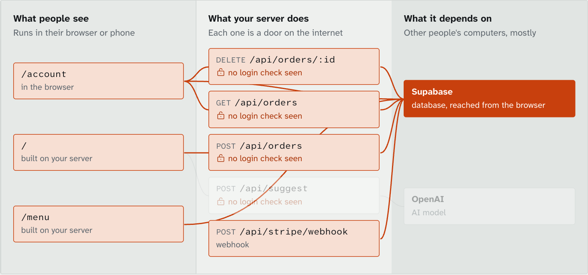
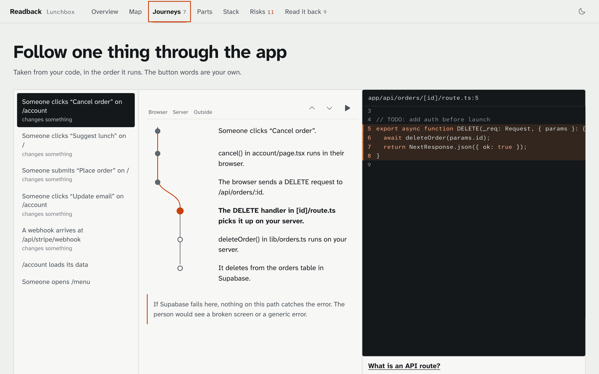
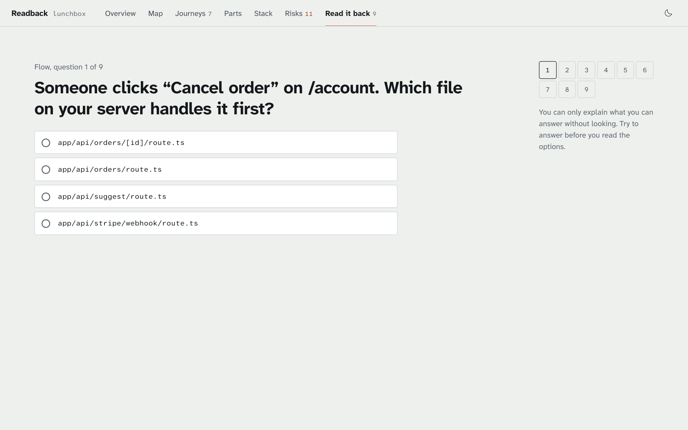

# Readback

**You shipped it. Can you explain it?**

Coding assistants let people ship apps they could not describe. Readback reads a project, shows what it actually does, and then tests whether you can say it back. It is named after what pilots do: repeat an instruction to prove they understood it.

It runs on your machine, needs no API key, and links every claim to the line of code it came from.

**[Try it in your browser](https://muhammadmurtuzahussain.github.io/readback/)** on a public repo, your own folder, or a sample app. Your files are read inside the tab.



## Run it

For private code, run it locally. There is no account and no key, and analysis makes no network calls.

```bash
npx https://github.com/MuhammadMurtuzaHussain/readback/releases/latest/download/readback.tgz ./my-app
```

This opens a report on `127.0.0.1`. Other options:

```bash
readback ./my-app --out report.html   # one shareable file, with code snippets inside it
readback ./my-app --json report.json  # the raw facts, for other tools
readback github.com/owner/repo        # shallow clone, analyse, delete
```

## What you get

| View | The question it answers |
| --- | --- |
| **Overview** | What is this, in plain sentences, with each noun linked to its evidence? |
| **Map** | What are the screens, the server's doors, and the services it stands on? Click a service to turn it off and see what breaks. |
| **Journeys** | What happens, step by step, when someone clicks this button? Named with your own button text, beside the real code. |
| **Parts** | Where does the code live, and what is each file for? |
| **Stack** | What is each technology, in plain English? What is installed but never used? |
| **Risks** | What could bite you? Each one comes with evidence, how to check it yourself, what the tool cannot see, and a fix prompt for your coding assistant. |
| **Read it back** | Can you answer questions about your own app? Wrong answers are real names from your repo. |





## How it stays honest

The rule of the codebase: anything shown as a fact carries evidence, and anything the engine cannot establish goes in a list of gaps.

- **Structure comes from parsing, not prediction.** JavaScript and TypeScript go through Babel, Python through tree-sitter. Both produce one code model, so everything downstream is language-blind.
- **Routes are proven.** A regex that matches `app.get()` also matches `cache.get()`. Readback follows `app` back to `express()`, follows routers through `app.use()`, and reports a router nobody mounted as a gap.
- **Calls are traced across the network.** A `fetch('/api/x')` in a component is matched to the server code that answers it, then followed into helpers, classes and injected dependencies to the database or AI call at the end.
- **Certainty is visible.** Steps and risks are marked `seen` or `inferred`. A login lookup that never stops anyone is reported as exactly that.
- **Secrets are masked.** Everything passes through a masking step before it reaches a report. `.env` files are never read.
- **A test holds it to this.** `tests/evidence.test.ts` walks every report and fails if any citation points at a file or line that does not exist, or if a code snippet differs from the source.

A model is optional and is only allowed to retell the facts. The narration prompt receives names and steps, never source files, and any sentence naming a file or service that is not in the facts is removed before it is shown. It works with Ollama, Anthropic or OpenAI.

## How it compares

| Tool | How it knows | Written for | Where your code goes |
| --- | --- | --- | --- |
| **Readback** | Parses code and traces calls, no model needed | The person who shipped it | Nowhere |
| [GitDiagram](https://github.com/ahmedkhaleel2004/gitdiagram) | A model reads the file tree and README | Developers exploring a repo | To a model provider |
| [DeepWiki](https://deepwiki.com) | A model writes a wiki | Developers exploring a repo | Public repos, hosted |
| [Understand-Anything](https://github.com/Lum1104/Understand-Anything) | Static analysis plus a team of model agents | Developers using a coding agent | To your model provider |
| [Archify](https://github.com/tt-a1i/archify) | Your coding agent writes the diagram, Archify validates its shape | Developers documenting systems | To your model provider |
| [Repomix](https://github.com/yamadashy/repomix) | Packs a repo into one file for a model | Giving context to a model | Wherever you paste it |

Those tools are good at what they do, and a model reads prose far better than this does. Readback makes a different trade: it knows less, but what it says can be checked. CodeSee, the best known visual tool in this space, was [acquired by GitKraken in 2024](https://www.gitkraken.com/press/gitkraken-acquires-codesee-launches-devex-platform).

## Limits

Read these before trusting a clean report.

- **It reads code, not your live setup.** Row level security turned on in a dashboard, a firewall, or a rule at your host are invisible to it.
- **A clean report is not a security audit.** Risks come from a fixed list of rules for common mistakes.
- **Dynamic behaviour is a blind spot.** Addresses built at runtime, plugin systems and reflection appear as gaps, or do not appear at all.
- **Depth depends on the language.** JavaScript, TypeScript and Python are traced. Other languages are listed, not followed.
- **Authentication checks are recognised by common names and libraries.** An unusual custom check can be reported as missing, and every such finding says so.
- **There are no types.** Tracing uses syntax and module resolution, with light use of annotations, so some calls through interfaces or dependency injection will not resolve.

## Development

```bash
npm install
npm test              # unit tests plus the evidence test
npm run build         # viewer, site and CLI
npm run inspect -- ./path/to/project full   # print what the engine found
```

To hold the evidence test against your own repos:

```bash
READBACK_CORPUS=/path/one:/path/two npm test
```

```
src/engine   Pure TypeScript with no file system or network access. Takes files, returns a report.
src/cli      Walks a folder, runs the engine, serves or writes the viewer.
src/ui       The report viewer, and the site that runs the engine in a Web Worker.
```

The engine is pure so the same code runs in Node and in a browser tab. That is what makes the no-upload claim checkable: open the network panel on the site and watch nothing go out but requests to GitHub.

To add a technology, add one entry to `src/engine/catalog.ts`. To add a check, add a rule to `src/engine/risks.ts` with its evidence, its caveat and a test.

## How this was built

Readback was built with an AI coding assistant, directed and reviewed by me. That is rather the point: I wanted a tool I would need myself. Its explanations of technologies are fixed text in this repo, and they can be wrong. Corrections are welcome.

## Licence

MIT
